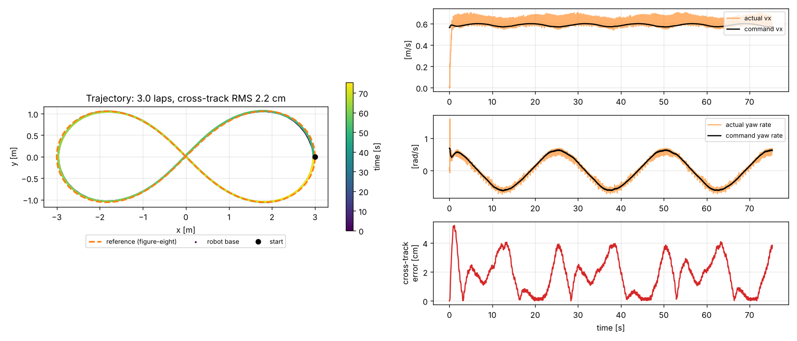

# Figure-eight walking of a quadruped robot (Go2) with Genesis + RL

Physical AI 2026 応用編1 最終課題。四足ロボット Unitree Go2 に、Genesis シミュレータ上で強化学習（PPO）した歩行方策を使って「八の字歩行」をさせます。自前 GPU なしで Google Colab（T4）だけで、学習から動画作成まで完結します。

## しくみ

```
 八の字経路（レムニスケート）
        │  ロボットの位置・向き
        ▼
 上位：Pure Pursuit 経路追従 ──► 速度コマンド [vx, vy, yaw rate]
        │
        ▼
 下位：PPO で学習した歩行方策（MLP 512-256-128） ──► 12関節の目標角度 ──► PD制御（Genesis）
```

- 下位の歩行方策は「速度コマンドに追従する」ことだけを学習します。八の字そのものは学習していないので、経路を変えても再学習なしで歩けます。
- 上位の Pure Pursuit は、経路上で前方 0.6 m の点を目標に旋回角速度を決めます。八の字の交差点で反対側の枝に飛び移らないよう、最近傍点を「前回位置の少し先」だけで探索しています。

## ファイル

| ファイル | 内容 |
|---|---|
| `pai_fig8_colab.ipynb` | Colab で上から実行するだけのノートブック（下の .py を書き出して実行） |
| `fig8_env.py` | 学習・評価用の環境（Genesis 公式 `go2_env.py` を改変） |
| `fig8_train.py` | PPO による学習（公式 `go2_train.py` を改変） |
| `fig8_eval.py` | 八の字経路追従の評価、2カメラ録画、軌跡・指標の保存 |
| `plot_results.py` | 軌跡・速度追従・経路誤差のグラフ |
| `make_video.py` | タイトル＋2画面＋結果グラフの提出用動画を作成 |

公式例からの主な変更点
- コマンド範囲：前進 0.5 m/s 固定 → 前進 0〜1.0 m/s、横 ±0.3 m/s、旋回 ±1.0 rad/s。20% の環境は旋回0（直進）、50% は横速度0。
- 報酬：`tracking_ang_vel` を 0.2 → 0.5 に強化し、`ang_vel_xy`（ロール・ピッチ角速度）、`orientation`（胴体の傾き）、`dof_acc`（関節加速度）のペナルティを追加。
- 評価：外部から速度コマンドを与える `set_commands()`、録画用カメラ（`debug=True` で参照経路と足跡も映す）。

## 実行方法

Colab で `pai_fig8_colab.ipynb` を開き、ランタイムを T4 GPU にして上から実行します。

ローカル（GPU あり）の場合：

```bash
pip install genesis-world==1.4.5 rsl-rl-lib==5.5.1 tensorboard
python fig8_train.py -e go2-fig8 -b 4096 --max-iterations 501
python fig8_eval.py -e go2-fig8 --ckpt 500
python plot_results.py && python make_video.py
```

## 参考

- Genesis: https://github.com/Genesis-Embodied-AI/Genesis （examples/locomotion）
- rsl_rl: https://github.com/leggedrobotics/rsl_rl
- google colabを利用して自前GPUなしでGenesisの強化学習を試す: https://tototototototo7.hatenablog.com/entry/2025/genesis_test_google_colab
- Genesis 入門 (11): https://note.com/npaka/n/n4ce9e0f69d33

## 学習済みモデルと結果

`pretrained/go2-fig8/` に検証用の学習済みモデル（1024 並列環境 × 800 反復、CPU で約 45 分）があります。学習せずに評価だけ試せます。

```bash
python fig8_eval.py --log-root pretrained -e go2-fig8 --ckpt 800
```

このモデルでの結果（`results/`）：八の字 3 周、転倒 0 回、経路からのずれ RMS 2.2 cm / 最大 5.2 cm。



## ライセンス

`fig8_env.py`・`fig8_train.py` は [Genesis](https://github.com/Genesis-Embodied-AI/Genesis)（Apache License 2.0）の `examples/locomotion` を改変したものです。
