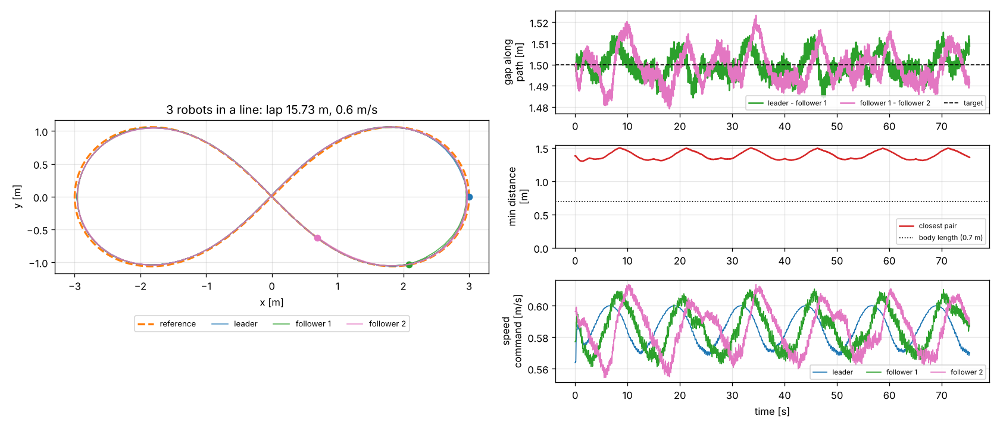

# Figure-eight walking of a quadruped robot (Go2) with Genesis + RL

Physical AI 2026 応用編1 最終課題。四足ロボット Unitree Go2 に、Genesis シミュレータ上で強化学習（PPO）した歩行方策を使って「八の字歩行」をさせます。自前 GPU なしで Google Colab（T4）だけで、学習から動画作成まで完結します。

## しくみ

```
 八の字経路（レムニスケート）
        │  ロボットの位置・向き
        ▼
 上位：Pure Pursuit 経路追従 ──► 速度コマンド [vx, vy, yaw rate]
        │
        ▼
 下位：PPO で学習した歩行方策（MLP 512-256-128） ──► 12関節の目標角度 ──► PD制御（Genesis）
```

- 下位の歩行方策は「速度コマンドに追従する」ことだけを学習します。八の字そのものは学習していないので、経路を変えても再学習なしで歩けます。
- 上位の Pure Pursuit は、経路上で前方 0.6 m の点を目標に旋回角速度を決めます。八の字の交差点で反対側の枝に飛び移らないよう、最近傍点を「前回位置の少し先」だけで探索しています。

## ファイル

| ファイル | 内容 |
|---|---|
| `pai_fig8_colab.ipynb` | Colab で上から実行するだけのノートブック（下の .py を書き出して実行） |
| `fig8_env.py` | 学習・評価用の環境（Genesis 公式 `go2_env.py` を改変） |
| `fig8_train.py` | PPO による学習（公式 `go2_train.py` を改変） |
| `fig8_eval.py` | 八の字経路追従の評価、2カメラ録画、軌跡・指標の保存 |
| `plot_results.py` | 軌跡・速度追従・経路誤差のグラフ |
| `scenery.py` | 動画用の景観（土の地面テクスチャと青空）。物理は学習時と同じ地面のまま。`--plain-scene` で Genesis 標準の見た目 |
| `make_video.py` | タイトル＋2画面＋結果グラフの提出用動画を作成 |
| `fig8_multi_eval.py` | 改良版：3台の隊列八の字歩行（隊列制御＋自動プランナー） |
| `plot_multi.py` | 改良版の軌跡・車間・速度のグラフ |

公式例からの主な変更点
- コマンド範囲：前進 0.5 m/s 固定 → 前進 0〜1.0 m/s、横 ±0.3 m/s、旋回 ±1.0 rad/s。20% の環境は旋回0（直進）、50% は横速度0。
- 報酬：`tracking_ang_vel` を 0.2 → 0.5 に強化し、`ang_vel_xy`（ロール・ピッチ角速度）、`orientation`（胴体の傾き）、`dof_acc`（関節加速度）のペナルティを追加。
- 評価：外部から速度コマンドを与える `set_commands()`、録画用カメラ（`debug=True` で参照経路と足跡も映す）。

## 改良版：Go2 3台の隊列八の字歩行（`fig8_multi_eval.py`）

同じ学習済み方策を3台で共有し、1つのシーン（ロボット同士の接触も物理計算）で縦一列に八の字を歩かせます。再学習は不要です。

- 先頭：八の字を Pure Pursuit で追従（巡航速度）
- 後続：同じ経路を追従しつつ、前の機体との「経路に沿った間隔」が目標値（既定 1.5 m）になるよう速度を調整
- 安全策：前方 ±60° 以内・1.0 m 以内に他の機体がいると減速、0.6 m で停止
- 自動プランナー：走らせる前に八の字の大きさ（1周の長さ）と速度を決めます
    1. 旋回：レムニスケートの最小旋回半径は a/3 なので、そこでの旋回角速度 3v/a が学習範囲の 60% 以下になるよう a を広げる（`--keep-size` なら速度 v を下げる）
    2. 交差点：経路上で半周離れた2台は交差点で出会うので、隊列全体の長さ (n−1)×間隔 ＋ 余裕 1.5 m が半周以下になるよう 1周の長さを広げる

結果（`results/multi/`、検証用モデル使用）：3台とも3周・転倒0、最小車間距離 1.30 m、間隔の誤差 RMS 0.7 cm。

プランナーの効果（`results/multi/planner_ablation.json`、間隔 3.5 m・半幅 3 m を指定）：プランナーなしでは交差点で先頭と最後尾が出会い、中心間距離が 0.73 m（ほぼ体長）まで近づいて安全策の急減速が働きました。プランナーありでは半幅を 3.24 m に広げ、最小 1.03 m を保ったまま減速なしで歩きました。



```bash
python fig8_multi_eval.py -e go2-fig8 --ckpt 500 --num-robots 3 --gap 1.5
python plot_multi.py --out-dir outputs_multi
```

## 改良版2：Go2 5台・交差点での一時停止と再開

隊列の長さが1周のちょうど半分になるよう、あえて「ぶつかる」設定にしています（5台・間隔 2 m・1周 16 m、プランナーなし）。このとき先頭と最後尾が八の字の交差点に同時にやってきます。

交差点の譲り合い制御（`CrossingManager`）のルールは次の4つです。

1. 交差点に入りかけている機体（停止線を越えた機体）と、交差点を出きっていない機体が最優先。
2. 同時に来る2台では、隊列の後ろの機体が先に通る。最後尾の後ろには誰もいないので、通り過ぎればすぐ交差点が空く。逆に最後尾を待たせると、隊列全体が通り終わるまで待つ間に先頭が1周して最後尾に追いつき、全員が動けなくなる（実際に試して確認）。
3. 待つ側は交差点の 1.1 m 手前の停止線まで減速して一時停止する。後ろの機体は約 1 m まで間隔を詰めて止まる。
4. 危険がなくなってから 0.5 秒たったら歩行を再開する（すぐ止まり直すのを防ぐヒステリシス）。

| 条件（5台・1周 16 m） | 2周の結果 |
| --- | --- |
| 譲り合い制御なし | 中心間の最小距離 0.12 m まで接近し、2台が衝突して転倒 |
| 譲り合い制御あり | 一時停止→再開を交差点で4回（1回 約4秒）。最小距離 1.06 m、転倒 0 |

動画では各機体の上に状態ランプ（緑＝歩行、黄＝減速、赤＝一時停止）を表示し、右画面は交差点のアップです。停止・再開のたびに `events.json` に時刻・機体・理由を記録します。

```bash
python fig8_multi_eval.py -e go2-fig8 --ckpt 500 --num-robots 5 --gap 2.0 --no-plan --size 3.05 --speed 0.5 --laps 2
# 比較用：譲り合い制御と近接時の減速を切る
python fig8_multi_eval.py -e go2-fig8 --ckpt 500 --num-robots 5 --gap 2.0 --no-plan --size 3.05 --speed 0.5 --laps 2 --no-yield --no-safety
```

## 実行方法

Colab で `pai_fig8_colab.ipynb` を開き、ランタイムを T4 GPU にして上から実行します。

ローカル（GPU あり）の場合：

```bash
pip install genesis-world==1.4.5 rsl-rl-lib==5.5.1 tensorboard
python fig8_train.py -e go2-fig8 -b 4096 --max-iterations 501
python fig8_eval.py -e go2-fig8 --ckpt 500
python plot_results.py && python make_video.py
```

## 参考

- Genesis: https://github.com/Genesis-Embodied-AI/Genesis （examples/locomotion）
- rsl_rl: https://github.com/leggedrobotics/rsl_rl
- google colabを利用して自前GPUなしでGenesisの強化学習を試す: https://tototototototo7.hatenablog.com/entry/2025/genesis_test_google_colab
- Genesis 入門 (11): https://note.com/npaka/n/n4ce9e0f69d33

## 学習済みモデルと結果

`pretrained/go2-fig8/` に検証用の学習済みモデル（1024 並列環境 × 800 反復、CPU で約 45 分）があります。学習せずに評価だけ試せます。

```bash
python fig8_eval.py --log-root pretrained -e go2-fig8 --ckpt 800
```

このモデルでの結果（`results/`）：八の字 3 周、転倒 0 回、経路からのずれ RMS 2.2 cm / 最大 5.2 cm。


## ライセンス

`fig8_env.py`・`fig8_train.py` は [Genesis](https://github.com/Genesis-Embodied-AI/Genesis)（Apache License 2.0）の `examples/locomotion` を改変したものです。
